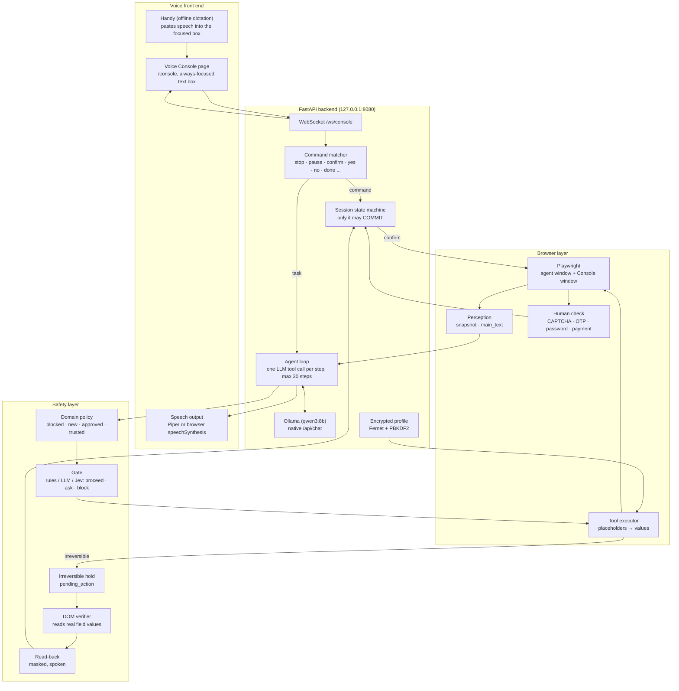
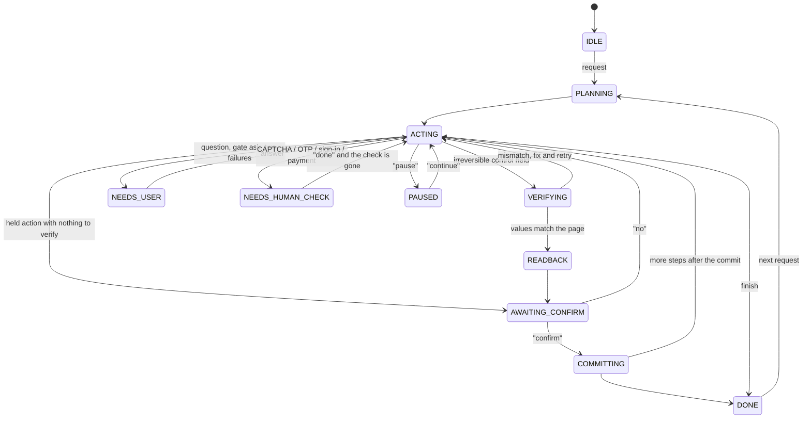

# Autonomous Voice Browser

<div align="center">

[](docs/PRD.md)
[](https://www.python.org/)
[](https://fastapi.tiangolo.com/)
[](https://playwright.dev/python/)
[](https://ollama.com/)
[](#key-features)
[](#automated-testing--safety-guarantees)

**A fully autonomous, voice-controlled web browser for blind and visually impaired users.**
<br />
Say what you want done. The agent does it in a real browser, tells you what it is doing, and stops only where a human must decide.

</div>

---

## 📑 Table of Contents

- [Executive Summary](#executive-summary)
- [Problem Statement & Background](#problem-statement--background)
  - [Why Existing Solutions Fail](#why-existing-solutions-fail)
  - [Our Approach](#our-approach)
- [System Architecture](#system-architecture)
  - [One Request, End to End](#one-request-end-to-end)
  - [Session State Machine](#session-state-machine)
- [Key Features](#key-features)
- [Safety Engineering in Depth](#safety-engineering-in-depth)
  - [1. Placeholders, Never Values](#1-placeholders-never-values)
  - [2. The Irreversible-Action Hold](#2-the-irreversible-action-hold)
  - [3. The Gate: Proceed, Ask or Block](#3-the-gate-proceed-ask-or-block)
  - [4. DOM Verification and Read-Back](#4-dom-verification-and-read-back)
  - [5. Human-Only Steps](#5-human-only-steps)
  - [6. Page Perception Within a Budget](#6-page-perception-within-a-budget)
- [Repository Structure](#repository-structure)
- [Quickstart](#quickstart)
  - [Prerequisites](#prerequisites)
  - [Local Setup](#local-setup)
  - [Try It Without Voice](#try-it-without-voice)
  - [Signed-In Chrome Mode (Gmail)](#signed-in-chrome-mode-gmail)
- [Configuration](#configuration)
- [Curated Demonstration Scenarios](#curated-demonstration-scenarios)
- [Automated Testing & Safety Guarantees](#automated-testing--safety-guarantees)
- [API Reference](#api-reference)
  - [REST Endpoints](#rest-endpoints)
  - [WebSocket Protocol (`/ws/console`)](#websocket-protocol-wsconsole)
  - [Agent Tools](#agent-tools)
- [Real-World Findings](#real-world-findings)
- [Development Workflow](#development-workflow)
- [Documentation Index](#documentation-index)
- [Authors & Acknowledgments](#authors--acknowledgments)
- [License](#license)

---

## Executive Summary

**Autonomous Voice Browser** turns a spoken request into a finished task on the web. The user says "find out where Kalpana Chawla was born", "apply for the disability pension on the demo portal" or "open my Gmail and read me my last mail". The agent then plans and carries out the whole task in a real browser: it searches, opens sites, reads pages, clicks, types, fills forms from an encrypted local profile and handles tabs, narrating as it goes.

It is a conversation, not a one-shot command. "Open Chrome", then "open Gmail", then "read my last mail" each run against the same browser and the same memory.

What sets it apart is **where it stops**. It does not ask permission for every click. It stops only at defined checkpoints, enforced in code rather than by prompt:

1. **Before anything irreversible** (submit, pay, send, delete, accept): it checks the real values on the page, reads them back, and waits for the user to say "confirm".
2. **Before typing personal data on a new site**: the user approves the domain once per session.
3. **At the human parts**: CAPTCHA, one-time codes, passwords and card details are handed to the user and never automated.
4. **On "stop"**: the loop halts within one step, every time.

Speech recognition, speech output and the language model all run locally.

---

## Problem Statement & Background

Screen readers make the web *readable* for blind users, but not *usable* at speed. Filling a two-tab government form means tabbing through dozens of unlabelled fields, catching validation errors that are only shown in red, and finding the one button that submits. A single mistyped digit in a PIN code can sink an application, and the user may never find out why.

### Why Existing Solutions Fail

- **Screen readers** read what is there, but the user still does every step by keyboard, one element at a time.
- **Voice assistants** answer questions but cannot operate an arbitrary website, fill a form, or deal with tabs and pop-ups.
- **General browser agents** are built for sighted users who watch the screen. They submit forms, accept terms and place orders on their own judgement, and they put personal data straight into prompts. For a user who cannot see the screen, that is the riskiest possible design.

### Our Approach

We give the agent **full autonomy for reversible work and none for irreversible work**:

- **Reversible actions** (navigate, search, read, open a tab, type ordinary text) run immediately, with a short spoken narration.
- **Irreversible actions** are physically impossible from the language model: it has no submit tool, and every irreversible control it tries to click is *held*.
- **Personal data never reaches the model.** It writes `{dob}`; code substitutes the value.
- **What was typed is verified on the page itself** before the read-back, so a site that silently mangles a value is caught. The demo portal plants exactly such a trap: its PIN-code field drops the last digit.

---

## System Architecture

The system has four parts: a voice front end (Handy, plus the Voice Console page), a FastAPI backend that runs the agent, a Playwright browser layer with perception, and a safety layer of gate, verifier and read-back.



### One Request, End to End

1. Handy pastes the spoken text into the Console, which sends an `utterance` over the WebSocket.
2. The **command matcher** handles commands directly (stop, confirm, repeat, ...). Anything else starts or continues a task.
3. The agent resolves the destination: a known site alias from `app/sites.json`, a URL, or a web search. The **domain policy** checks it and the agent announces the new domain.
4. Each step runs the same cycle:
   - a **perception snapshot** of the page;
   - **one LLM tool call**, validated;
   - the **gate**, for risky actions;
   - the **executor** in Playwright;
   - a **human-check scan**.
5. An irreversible control is not clicked. The executor stores it as `pending_action`, then the **verifier** checks every field on the page, the **read-back** is spoken, and the user says "confirm". Only then does the state machine call `commit_pending`.
6. The agent ends with `finish(summary)`, which is spoken.

### Session State Machine



The full table is `TRANSITIONS` in `app/session.py`. Three rules sit outside it:
- **Any state may go to `IDLE`** ("stop" always works). That clears the held action, the confirmation and any saved state.
- **`PAUSED` and `NEEDS_HUMAN_CHECK` remember where they came from** and can only go back there.
- **`COMMITTING` needs `confirmed = True` and a `pending_action`.** Any other route raises `IllegalTransition`.

---

## Key Features

### 🗣️ Conversational, Hands-Free Control
- **Speak naturally**: Handy (offline Whisper or Parakeet) pastes speech into the Console; commands such as *stop*, *pause*, *continue*, *repeat*, *confirm*, *where* and *help* are matched in code.
- **One browser, one memory**: every sentence continues the same session, so "open Gmail" after "open Chrome" just works.
- **Short narration**: one phrase per step; full sentences only for answers, questions and read-backs. Digits are spoken one by one ("5 6 0 0 0 1").
- **Escape is stop, Space is pause** in the Console, for keyboard users.

### 🌐 Full Browser Autonomy
- **Search, navigate, read, click, type, select, scroll, switch and close tabs**, through 15 typed tools.
- **Readable pages**: `main_text` returns the article without menus, sidebars, footers or cookie banners; Gmail messages are read subject first, newest message first.
- **New tabs are followed and announced** ("opened a new tab: Help guide").
- **Known sites by name**: "pension portal", "wiki", "the hindu", "gmail", and more in `app/sites.json`.

### 🔐 Safety by Construction
- **No submit tool**: irreversible controls are flagged by perception and held by the executor.
- **Placeholders only**: the model never sees Aadhaar, bank account, IFSC or the PIN.
- **Verify before confirm**: the DOM verifier compares what is really on the page with what was meant, after type-aware normalisation.
- **Untrusted page content**: page and email text are labelled as data in every prompt. The mock inbox even plants a prompt-injection email to prove it.
- **Console origin check**: only the agent's own Console page may connect, so no web page can send "confirm".

### 🧭 Real Browser, Real Accounts
- **Three browser modes**:
  - `chromium`: Playwright's own Chromium, fresh each time;
  - `chrome`: your installed Chrome with a persistent agent profile, so you stay signed in;
  - `attach`: an already-running Chrome.
- **Sign in once, by hand**: the Gmail sign-in survives restarts (proved on Chrome 156, see [Real-World Findings](#real-world-findings)).
- **Focus that holds**: the Console window takes OS focus back after every agent action, so Handy always pastes into the right box (5/5 on Windows, in both modes).

### 🧪 Offline Demo Kit
- **Mock disability-pension portal**: a two-tab form, a fake "I'm not a robot" check, and the planted PIN-code trap.
- **Mock open web**: a search page, an article, a shop with cart and checkout, an inbox with messages, sign-in and OTP pages.
- **Typed try-out script**: run any task without a microphone (`scripts/run_task.py`).

---

## Safety Engineering in Depth

The seven hard rules are in [`CLAUDE.md`](CLAUDE.md) and [`docs/PRD.md`](docs/PRD.md) Section 10. Here is how the code enforces them.

### 1. Placeholders, Never Values

The language model fills a field with a placeholder:

```json
{"name": "fill_field", "args": {"field_id": "f3", "value_ref": "{dob}"}}
```

The executor resolves `{dob}` from the decrypted profile, types it, and records an expected-value entry for the verifier. Values for `SENSITIVE_KEYS` (Aadhaar, bank account, IFSC, PIN) are typed only on a `trusted` domain or one the user approved in this session. They are masked to the last four digits in the Console and the read-back. The audit log drops them automatically.

### 2. The Irreversible-Action Hold

Perception labels every button, submit input, `role=button` control and action link with `irreversible` and a `kind`. The rules are applied in order, and the first one that matches wins:

| Order | Signal | Example | Result |
|---|---|---|---|
| 1 | Visible text or accessible name, checked as pay → delete → send → post → accept → submit | "Submit payment" | `pay` |
| 2 | Target hints: id, name, class, `data-action`, `formaction`, form action, href | icon-only `#send-btn` | `send` |
| 3 | Any submit of a non-search form | "Continue" in a POST form | `submit` |
| 4 | Otherwise | "Add to cart", "Next", "Search" | `other` (reversible) |

A link is promoted to a held button only for a short command ("Buy now", "Delete this message") or an action address (`/mail/delete`). Notices such as "Post Matric Scholarship" on gov.in stay links. "Accept" inside a cookie banner is not held.

`click(element_id)` on an irreversible control never clicks. It stores the control as `session.pending_action`. `commit_pending` refuses to run unless the state machine has `confirmed = True`.

### 3. The Gate: Proceed, Ask or Block

Before a risky action, the gate (`app/gate.py`) asks two questions: *does this action serve the user's stated goal?* and *is this the right element for this value?* The `rules` backend is deterministic and the default; `llm` and `jev` (TypeSafe AI's evaluator) are opt-in. A backend's probability $p$ maps to a decision with thresholds from `.env`:

$$
\text{decision}(p) =
\begin{cases}
\text{proceed} & p \ge 0.85 \\
\text{ask the user} & 0.5 \le p < 0.85 \\
\text{block} & p < 0.5
\end{cases}
$$

If the gate says `ask_user`, or the same step fails twice, the agent asks one short question instead of guessing.

### 4. DOM Verification and Read-Back

Before a held submit is offered for confirmation, the verifier reads the **real** values back from the page: inputs, the visible text of dropdowns, checkboxes. It compares them with the expected values after type-aware normalisation (dates, phone numbers with or without +91, Aadhaar digit grouping, case and spacing). Each field comes back as `ok`, `mismatch`, `missing` or `error`.

On the demo portal the PIN-code field silently drops its last digit (`560001` → `56000`). The verifier catches it, and the agent re-enters the value before reading anything back. The read-back then speaks the form, masked, and states the pending action: *"I'm about to press Submit application on demo portal."*

### 5. Human-Only Steps

After every navigation and click, `app/humancheck.py` scans every frame for steps a person must do:

| Kind | Detected from | Counts as done when |
|---|---|---|
| `captcha` | the mock robot check, reCAPTCHA, hCaptcha, Turnstile widgets and frames | the box is ticked or the response token is set |
| `otp` | `autocomplete="one-time-code"`, fields named or labelled OTP / verification code | every code field is filled |
| `payment` | card fields (`cc-*`, CVV, expiry), Stripe / Razorpay / Paytm / PayPal frames | every card field is filled; "Place order" is still held |
| `password` | password fields; Google, Microsoft and Apple sign-in domains | the page has moved past sign-in. A typed password is not enough, so the agent never presses "Sign in" |

The agent saves its state, says what is needed, waits for "done", asks the detector again, and resumes. The model never sees the challenge.

### 6. Page Perception Within a Budget

The snapshot gives the model at most **60 elements**, each with a label under 60 characters. Elements are taken in this order: form fields, buttons, tabs, links, then ARIA toggles. Each gets an id (`f3`, `b2`, `l7`, `t1`) that maps to a locator only the executor sees.

Labels fall back from `<label>` to `aria-labelledby`, `aria-label`, placeholder, title, nearby text, name and id. A button repeated on every row (Gmail's 50 star buttons) is listed twice at most, so it cannot crowd out the rows. Iframes are included, cross-origin ones too. Values of sensitive fields are reported only as `(filled)`.

---

## Repository Structure

```
PESU-Agentathon-/
├── app/                        # Backend (Python, FastAPI)
│   ├── main.py                 # HTTP + WebSocket server, Console, command routing        (M1)
│   ├── config.py               # Every setting, read from .env                            (M1)
│   ├── session.py              # Session, state machine, the only path to COMMITTING      (M1)
│   ├── agent.py                # Autonomous agent loop, confirmation flow                 (M1)
│   ├── llm.py                  # Ollama /api/chat, validated tool calls                   (M1)
│   ├── tools.py                # Tool schemas, executor, domain policy, irreversible hold (M1)
│   ├── profile.py              # Encrypted profile (Fernet, PBKDF2)                       (M1)
│   ├── voice.py                # Speech in/out, command matcher, digit handling           (M2)
│   ├── onboarding.py           # Spoken profile set-up and unlock                         (M2)
│   ├── browser.py              # Playwright controller: windows, tabs, modes, focus       (M3)
│   ├── perception.py           # Snapshot, main text, irreversible flags                  (M3)
│   ├── humancheck.py           # CAPTCHA / OTP / password / payment detection             (M3)
│   ├── sites.json              # Site directory: aliases, domains, trusted flag           (M3)
│   ├── gate.py                 # Proceed / ask / block (rules, LLM, Jev)                  (M4)
│   ├── verifier.py             # Reads real field values back from the page               (M4)
│   ├── readback.py             # Spoken, masked read-back                                 (M4)
│   └── audit.py                # Audit log that drops sensitive keys                      (M4)
├── client/                     # Voice Console (React); a placeholder page is served until built (M2)
├── mock_site/                  # Offline demo sites, served on :8000                     (M3)
│   ├── portal/                 # Disability pension portal with the PIN-code trap
│   └── web/                    # Search, article, shop, cart, checkout, inbox, sign-in, OTP
├── scripts/                    # Try-out, checks and set-up scripts
├── tests/                      # Unit and integration tests; tests/e2e/ for demo scenarios (M4)
├── docs/                       # PRD, demo script, rehearsal plan, research notes
├── .env.example                # All settings with defaults
├── CLAUDE.md / AGENTS.md       # Rules for coding agents
└── HANDOFF.md                  # Project state
```

---

## Quickstart

### Prerequisites

- **Python 3.11+**
- **[Ollama](https://ollama.com)** with the `qwen3:8b` model
- **Google Chrome**, only for the signed-in `chrome` mode
- **[Handy](https://github.com/cjpais/Handy)**, only for voice input (typing in the Console works without it)

Commands below are for Windows PowerShell. On macOS or Linux, activate with `source .venv/bin/activate` and copy with `cp`.

### Local Setup

#### 1. Clone and install

```powershell
git clone https://github.com/SudeeptiSagar/PESU-Agentathon-.git
cd PESU-Agentathon-
python -m venv .venv
.venv\Scripts\Activate.ps1
pip install -r requirements.txt
playwright install chromium
```

#### 2. Configure

```powershell
copy .env.example .env            # edit as needed; never commit .env
ollama pull qwen3:8b
```

#### 3. Start the three parts, each in its own terminal

```powershell
ollama serve                                        # if Ollama is not already running
cd mock_site; python -m http.server 8000            # mock portal, shop, search and inbox
python -m app.main                                  # backend on http://localhost:8080
```

#### 4. Open the Voice Console

Open **http://localhost:8080/console**. Its text box keeps focus so Handy can paste what you say into it. Until the React Console in `client/` is built (`cd client; npm ci; npm run build`), the backend serves a placeholder Console that speaks the same WebSocket protocol.

> If port 8080 is taken on your machine, set `PORT=8090` (or any free port) in `.env`.

### Try It Without Voice

```powershell
python scripts/run_task.py --mock --demo-profile "apply for the disability pension on the demo portal"
python scripts/run_task.py "find out where Kalpana Chawla was born"
```

The script uses the real browser and model. When the agent asks something or holds an action, type your reply: `yes`, `no`, `confirm`, `done`, `stop`, or any sentence.
- `--mock` serves `mock_site/` and uses the mock search, so no real website is touched.
- `--demo-profile` uses a made-up profile in memory.

### Signed-In Chrome Mode (Gmail)

Set `BROWSER_MODE=chrome` in `.env`. The backend then starts your installed Chrome with:
- a **separate, persistent agent profile** (`AGENT_PROFILE_DIR`, default `~/.voiceagent/chrome-profile`, outside the repo);
- **remote debugging on 127.0.0.1 only**.

It then attaches over CDP. Sign in to Gmail **once, by hand**; the agent never types passwords. To prove the sign-in persists:

```powershell
python scripts/chrome_login_test.py
```

It opens the agent Chrome, waits while you sign in, restarts Chrome with the same profile and reports PASS if Gmail opens the inbox. Chrome 136 and later allow remote debugging only on a non-default profile, which is why the agent has its own.

---

## Configuration

All settings live in `.env` (template: [`.env.example`](.env.example)) and are read only through `app/config.py`.

| Setting | Default | Purpose |
|---|---|---|
| `OLLAMA_URL` · `LLM_MODEL` · `NUM_CTX` | `http://localhost:11434/v1` · `qwen3:8b` · `8192` | Local LLM; `llm.py` calls Ollama's native `/api/chat` so `NUM_CTX` takes effect |
| `SEARCH_URL` | DuckDuckGo HTML | Offline: `http://localhost:8000/web/search.html?q={q}`; fallback: `https://www.bing.com/search?q={q}` |
| `MAX_STEPS` · `MAX_FAILURES` · `BLOCKED_DOMAINS` | `30` · `2` · empty | Autonomy limits and blocked sites |
| `BROWSER_MODE` · `BROWSER_HEADLESS` | `chromium` · `false` | `chromium`, `chrome` or `attach`; headless only for tests |
| `CHROME_PATH` · `CHROME_DEBUG_PORT` · `AGENT_PROFILE_DIR` | auto-detect · `9222` · `~/.voiceagent/chrome-profile` | Signed-in Chrome mode |
| `STT_BACKEND` · `TTS_BACKEND` · `PIPER_VOICE` | `handy` · `browser` · empty | Speech in (`handy`, `whisper`) and out (`piper`, `browser`) |
| `GATE_BACKEND` · `GATE_PROCEED` · `GATE_ASK` · `JEV_API_KEY` | `rules` · `0.85` · `0.5` · empty | Gate backend (`rules`, `llm`, `jev`) and thresholds |
| `HOST` · `PORT` | `127.0.0.1` · `8080` | Backend address |

Known sites are in [`app/sites.json`](app/sites.json). `trusted: true` (only the local mock sites) lets the agent type profile values without asking first. Every other domain needs the user's approval once per session.

---

## Curated Demonstration Scenarios

| Scenario | Say | Observed behaviour |
|---|---|---|
| **🔎 A. Open-web lookup** | "Find out where Kalpana Chawla was born" | Searches, opens the article, reads it and answers with the birthplace (Karnal). Works on the mock search offline (which includes a sponsored distractor) or on the real web |
| **📝 B. Government form** | "Apply for the disability pension on the demo portal" | Opens the portal, fills both tabs from the profile, the verifier catches the truncated PIN code and the agent fixes it, pauses for "I'm not a robot", reads the form back (masked), submits only after "confirm", speaks the acknowledgment number |
| **🛒 C. Shopping stop point** | "Buy a white cane from the demo shop" | Adds to cart, fills delivery details, then hands over at the card form; "Place order" stays held |
| **📧 D. Own Gmail** | "Open my Gmail and read me my last mail" | In the signed-in agent Chrome: opens the inbox, opens the newest message, reads subject, sender and body. Read-only; send, reply and delete are held |
| **✋ Stop anywhere** | "Stop" (or Escape) | The loop halts within one step |

The full presenter script, timings and backup plans are in [`docs/DEMO.md`](docs/DEMO.md).

---

## Automated Testing & Safety Guarantees

Each owner tests their own module, and M4's end-to-end harness checks the safety chain across all of them:

| Test file | Guarantees |
|---|---|
| `test_smoke.py` | Every module imports and exposes the PRD Section 12 contract; there is no submit or commit tool |
| `test_session.py` · `test_confirmation.py` | Only legal state transitions; `COMMITTING` needs `confirmed` and a pending action; the confirm flow |
| `test_tools.py` · `test_resolve.py` | Placeholder substitution, domain policy, irreversible controls held not clicked, site and intent resolution |
| `test_agent.py` · `test_main.py` | Step cap, failure handling, "stop" within one step, WebSocket and Console wiring |
| `test_llm.py` · `test_reliability.py` | Validated tool calls and one retry on malformed output; tool-choice reliability |
| `test_profile.py` · `test_audit.py` | Encryption round-trip and wrong-PIN error; sensitive keys never logged |
| `test_gate.py` · `test_verifier.py` · `test_verifier_portal.py` · `test_readback.py` | Gate decisions; the verifier catches the truncated PIN code and missing fields; masked read-back |
| `test_browser.py` · `test_browser_modes.py` | Tabs, new-tab announcement, Console focus; `chromium` / `chrome` / `attach` modes |
| `test_perception.py` · `test_perception_irreversible.py` | Contract JSON on every mock page, label fallbacks, iframes, caps, no sensitive values; **every control on every mock page flagged correctly** |
| `test_humancheck.py` · `test_task_d.py` · `test_sites.py` | Human-only steps detected and cleared; the Gmail flow; site directory valid, only mocks trusted |
| `test_mock_portal.py` · `test_mock_web.py` | The mock sites behave as the demo needs, including the PIN-code trap |
| `tests/e2e/` | Demo scenarios A, B and C end to end: trap caught, human check paused and resumed, nothing irreversible without "confirm" |

### Running the Test Suite

```powershell
# Unit and integration tests: offline and headless, about 3 minutes
python -m pytest -q

# End-to-end demo scenarios (deselected by default)
python -m pytest -m e2e -q -rs
python -m tests.e2e.run_demo          # A / B / C as a pass-fail report

# Opt-in: real sites, real Chrome, real Gmail
$env:RUN_NETWORK_TESTS = "1"          # Wikipedia, The Hindu, gov.in, Bing
$env:RUN_REAL_CHROME = "1"            # chrome and attach modes, throwaway profile
$env:RUN_REAL_GMAIL = "1"             # needs the signed-in agent profile; prints no email text
python -m pytest -q
```

Useful checks:
- `scripts/focus_test.py --mode chrome`: Console focus across 5 agent clicks.
- `scripts/real_site_check.py`: perception on real sites, headless and headed.
- `scripts/check_llm.py`: the Ollama connection.
- `scripts/reliability_test.py`: tool-choice reliability, with a 9/10 target.

---

## API Reference

### REST Endpoints

| Method | Path | Returns |
|---|---|---|
| `GET` | `/health` | `{"status": "ok", "model", "tts", "stt", "gate", "browser", "console_built"}` |
| `GET` | `/console` | The Voice Console (built React app, or the placeholder) |

### WebSocket Protocol (`/ws/console`)

The Console opens a persistent connection to `ws://localhost:8080/ws/console`. Only the agent's own Console origin is accepted.

#### Inbound (Console → backend)

```json
{ "type": "utterance", "text": "apply for the disability pension on the demo portal" }
{ "type": "key", "name": "Escape" }
{ "type": "key", "name": "Space" }
```

`Escape` stops the agent. `Space` (with an empty text box) pauses or continues it. Only the backend's command matcher can turn an utterance into a confirmation; the Console never sets `confirmed` itself.

#### Outbound (backend → Console)

Example values:

```json
{ "type": "state", "name": "AWAITING_CONFIRM" }
{ "type": "speak", "text": "I'm about to press Submit application on demo portal. Say confirm to go ahead, or no." }
{ "type": "step", "n": 7, "action": "fill_field", "target": "f5 {pin_code}", "result": "Filled PIN code" }
{ "type": "field_table", "fields": [ { "label": "Aadhaar number", "value_masked": "•••• 9012", "status": "ok" },
                                     { "label": "PIN code", "value_masked": "56000", "status": "mismatch" } ] }
{ "type": "pending", "description": "Submit application on demo portal" }
{ "type": "alert", "level": "warning", "message": "PIN code shows 56000, expected 560001." }
```

### Agent Tools

The language model may call only these tools. There is deliberately **no submit or commit tool**.

| Tool | Purpose |
|---|---|
| `navigate(target)` | Open a site alias from `sites.json` or a URL; domain policy applies |
| `web_search(query)` | Open `SEARCH_URL` with the query |
| `read_page(mode)` | `summary`, `main_text` or `fields` |
| `click(element_id)` | Click; irreversible controls are held, not clicked |
| `type_text(field_id, text)` | Non-sensitive text from the user or the task |
| `fill_field(field_id, value_ref)` | A profile placeholder such as `{dob}` |
| `select_option(field_id, option)` · `press_key(key)` · `scroll(direction)` · `go_back()` | Page interaction |
| `switch_tab(index)` · `close_tab(index)` | Tabs |
| `ask_user(question)` · `speak(text)` · `finish(summary)` | Talking to the user |

---

## Real-World Findings

Checked against live sites with Playwright on Windows 11. Details and dates are in [`docs/REAL_SITE_NOTES.md`](docs/REAL_SITE_NOTES.md).

| Finding | Consequence |
|---|---|
| A Gmail sign-in made by hand in the agent's Chrome survived two restarts, with no "browser may not be secure" warning (Chrome 156) | The signed-in `chrome` mode is the main mode for Task D |
| Chrome 136+ ignores remote debugging on the default profile | The agent uses its own profile folder, outside the repo |
| DuckDuckGo blocks headless browsers (403) but works headed | The agent runs headed; Bing or the mock search are the fallbacks; tests do not depend on DuckDuckGo |
| www.india.gov.in returns 403 to Playwright | `sites.json` uses socialjustice.gov.in for gov.in |
| Gmail inbox rows are `role=link` divs, and 50 ARIA checkboxes and stars filled the element budget | Perception collects `role=link`, lists toggles last and limits repeated buttons |
| Gmail and search results render after "load" | Perception waits for them on those sites |

No automation is ever hidden: no stealth flags, no fake user agent, no `navigator.webdriver` tricks.

---

## Development Workflow

We built this in 24 hours as four owners working in parallel against one shared contract:

1. **Contract first.** [`docs/PRD.md`](docs/PRD.md) Section 12 fixes every module's signature and every WebSocket event before any code. A CORE-01 skeleton committed those stubs, so all four owners could build against them at once.
2. **One ticket, one branch, one PR.** Tickets are GitHub issues titled `[TICKET-ID] ...`, for example `BRW-03`. Each lives on a `<core|ui|browser|jev>/<TICKET-ID>-<name>` branch and merges with `Closes #<issue>`.
3. **Owners edit only their own files.** Contract changes go through the lead (M1).
4. **Proof before build.** Risky assumptions get a spike first: whether Google accepts a hand sign-in in a debug-profile Chrome (BRW-07), whether `/v1` honours `num_ctx` (CORE-02, it did not), whether Handy focus holds (UI-04).
5. **Real output, not summaries.** Every PR reports the actual test output, and real-site checks are recorded in the docs.
6. **Rules for coding agents.** [`CLAUDE.md`](CLAUDE.md) and `AGENTS.md` carry the hard safety rules and ownership, so AI pair-programmers follow them too.

---

## Documentation Index

| Document | Contents |
|---|---|
| [`docs/PRD.md`](docs/PRD.md) | Product, architecture, safety design, interface contract (Section 12), tickets (Section 21). Version 3.2 |
| [`docs/DEMO.md`](docs/DEMO.md) | Demo script, timings, pre-demo checklist, backup plans, likely judge questions |
| [`docs/REHEARSAL.md`](docs/REHEARSAL.md) | Rehearsal schedule and set-up |
| [`docs/REAL_SITE_NOTES.md`](docs/REAL_SITE_NOTES.md) | Real sites, blocking, the Gmail sign-in proof, fallbacks |
| [`docs/JEV_NOTES.md`](docs/JEV_NOTES.md) | Jev and jevals research, gate backend decision |
| [`docs/LLM_RELIABILITY.md`](docs/LLM_RELIABILITY.md) · [`docs/OLLAMA_CHECK.md`](docs/OLLAMA_CHECK.md) | Model choice and tool-call reliability |
| [`docs/REFERENCE_NOTES.md`](docs/REFERENCE_NOTES.md) | Notes on the design reference project |
| [`HANDOFF.md`](HANDOFF.md) · [`CLAUDE.md`](CLAUDE.md) | Project state; rules for coding agents |

---

## Authors & Acknowledgments

| Role | Member | Owns |
|---|---|---|
| **M1 · Core backend & integration (lead)** | [Prashanth](https://github.com/pruthviprashanth) | Agent loop, LLM, state machine, tool executor, profile, server |
| **M2 · UI, frontend & voice** | [Vishal](https://github.com/VishalAprameya4) | Voice Console, speech in and out, onboarding |
| **M3 · Browser perception & sites** | [Sudeepti Sagar](https://github.com/SudeeptiSagar) | Browser control and modes, perception, human check, site directory, mock sites |
| **M4 · Jev, verification & demo** | [Abishek](https://github.com/abishekraom) | Gate, DOM verifier, read-back, audit, end-to-end tests, demo |

- **[Handy](https://github.com/cjpais/Handy)** (MIT) for offline speech recognition. Handy's name and logo are its own; we credit it and do not rebrand it.
- **[Ollama](https://ollama.com)** and **Qwen3** for the local language model; **[Playwright](https://playwright.dev)** for browser automation; **[Piper](https://github.com/rhasspy/piper)** for speech output.
- **Jev / jevals** by TypeSafe AI for the optional semantic gate.
- **Wayfinder** (`pascalLangdock/elevenlabs_hack`) was a design reference only; no code was copied.
- Built in 24 hours for **Agentathon 2026**.

---

## License

No license file has been added yet, so all rights are reserved by the authors for now. Third-party components keep their own licenses (Handy is MIT).
